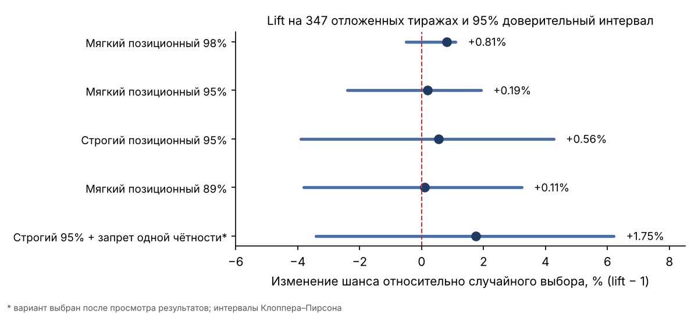

# Есть ли в лотерее комбинации, которые никогда не выиграют?


## С чего всё началось

У меня есть хороший знакомый, который уже много лет играет в EuroJackpot. У него есть любимая комбинация чисел, и он ставит всегда только её — тираж за тиражом, год за годом.

> EuroJackpot — международная лотерея, которую с 2012 года разыгрывают сразу 18 европейских стран, от Германии и Италии до Польши и Финляндии. Ставки всех стран собираются в общий призовой фонд, поэтому джекпот бывает огромным: минимум 10, максимум 120 миллионов евро. Тиражи проходят по вторникам и пятницам в Хельсинки. Игрок выбирает 5 чисел из 50 и 2 «евро-числа» из 12; шанс сорвать джекпот — примерно 1 к 140 миллионам.

И однажды случилось то, чего боится каждый такой игрок: он пропустил тираж, а именно в этот раз выпала комбинация, в которой **четыре числа из пяти совпадали с его любимыми**. Не джекпот, но вполне ощутимый выигрыш, который он не получил, потому что как раз в тот раз не играл.

Я был уверен, что после этого он сменит комбинацию. Ведь она «уже отстрелялась», шанс, что четыре её числа снова совпадут с выигрышными, совсем мал. Но он ничего не поменял и до сих пор играет теми же числами.

Мне это казалось контринтуитивным. Я был почти убеждён, что эта комбинация больше никогда не выиграет. И тогда мне пришла в голову идея: а что если написать сервис, которому даёшь комбинацию, а он отвечает: «Эта комбинация маловероятна, потому что…» — и называет причину? Например, «слишком похожа на недавний выигрыш», «слишком маленькая сумма», «пять чисел подряд».

Я придумал несколько правил, которые казались мне интуитивно верными, и решил проверить их перебором и статистикой.

Обычно люди придумывают стратегии, чтобы угадать выигрышную комбинацию: изучают «горячие» и «холодные» числа, ищут повторяющиеся последовательности, анализируют прошлые тиражи и пытаются предсказать следующий. Моя идея, выросшая из истории со знакомым, была **противоположной**.

**Я не собирался искать числа, которые могут выиграть. Я хотел найти комбинации, которые с большой вероятностью *не* окажутся выигрышными, исключить их и тем самым повысить шанс среди оставшихся вариантов.** Иными словами, не предсказывать победителя напрямую, а сократить пространство всех комбинаций.

Если розыгрыш равномерен, то исключение «необычных» комбинаций не даст преимущества. Но мне хотелось проверить, не обнаружится ли в реальных данных отклонение от этой модели.

Вместо поиска закономерностей я решил превратить идею в проверяемый эксперимент: архив тиражей, набор гипотез, точный перебор комбинаций, тесты, автоматизация и проверка на данных, которых алгоритм не видел при подборе правил.

Спойлер: **убедительного способа повысить вероятность выигрыша я не нашёл**. И вот почему это не то же самое, что «ничего не получилось».

## Сколько комбинаций и почему хочется их отсеивать

В актуальной версии EuroJackpot нужно угадать пять чисел из 50 и два дополнительных из 12. Всего:

```text
C(50, 5) = 2 118 760
C(12, 2) =        66

2 118 760 × 66 = 139 838 160 комбинаций
```

Для одного конкретного билета вероятность джекпота при честном независимом розыгрыше — **1 к 139 838 160**.

Идея казалась простой: некоторые сочетания выглядят настолько необычно, что их можно исключить. Например, все пять чисел подряд; четыре числа, совпадающие с прошлым тиражом; слишком маленькая сумма чисел, все пять чисел в одном узком диапазоне и т.д.

Но тут обнаруживается первая ловушка. **Редкое событие — не обязательно менее вероятное, чем любое другое конкретное событие.** Комбинация `1, 2, 3, 4, 5` выглядит подозрительно. Комбинация `7, 19, 28, 34, 46` — обычно. Однако при равномерном розыгрыше обе имеют одинаковую вероятность.


## Данные и гипотезы

Исходный архив содержит **987 тиражей с 23 марта 2012 года по 4 сентября 2026-го**. Для задач, связанных с двумя дополнительными числами, учитывается изменение правил: современная схема 2 из 12 действует с марта 2022 года.

Я проверял не одну «формулу», а несколько семейств гипотез:

- **Повторы и переходы.** Сколько чисел повторилось относительно прошлого тиража? Как часто подряд появляются две комбинации с большой суммой?
- **Геометрия отсортированной пятёрки.** Минимум, максимум, размах, расстояния между соседними числами, арифметические прогрессии.
- **Позиционные диапазоны.** В какие интервалы обычно попадает первое, второе, третье, четвёртое и пятое число после сортировки?
- **Чётность и структура.** Сколько чётных, сколько чисел из верхней половины, сколько попало в одну десятку?
- **Адаптивные признаки.** Возраст числа с последнего появления, интервалы между появлениями, распределение расстояний.
- **Спектральный анализ.** Не скрывается ли периодичность в последовательностях появления чисел?
- **Поведение игроков.** Выбирают ли люди «красивые» комбинации чаще случайных?

Часть гипотез проверялась точным перебором всех **2 118 760** основных пятёрок. Для более дорогого исторического walk-forward использовалась воспроизводимая равномерная выборка из 10 000 пятёрок с фиксированным seed.

## Очень редкое не означает аномальное

Например, вероятность получить ровно три числа из предыдущей пятёрки при независимом розыгрыше вычисляется комбинаторно:

```text
P(ровно k совпадений) =
C(5, k) × C(45, 5-k) / C(50, 5)
```

Для трёх совпадений получается около **0,467%**, то есть в среднем **4,6 случая** на 986 переходов между тиражами. В архиве я обнаружил **4 случая**, или **0,406%**.

Выглядит необычно? Да. Отличается от модели случайного розыгрыша? Нет, вполне укладывается в неё.

Другой пример — **два тиража подряд с необычно маленькой суммой пяти основных чисел**. Я считал сумму маленькой, если она не превышала 80. Представим два последовательных тиража:

```text
Первый:  2, 7, 11, 18, 25  → сумма 63
Второй:  3, 8, 14, 21, 29  → сумма 75
```

*Это вымышленные комбинации для иллюстрации правила, а не номера реальных исторических тиражей.*

При равномерном выборе пяти чисел из 50 вероятность суммы не больше 80 составляет примерно **6,58%**. Если тиражи независимы, вероятность двух таких сумм подряд — **0,43%** (0,0658 × 0,0658), то есть около **4,3 случая** на 986 переходов. В моём архиве нашлось **8** — почти вдвое больше ожидания.

На первый взгляд это похоже на закономерность. Но у правила есть зеркальный близнец.

Отразим числа относительно середины диапазона: заменим каждое число `x` на `51 − x`. Тогда 1 превращается в 50, 2 — в 49, …, 25 — в 26, и любая комбинация переходит в другую допустимую комбинацию. Сумма при этом меняется так:

```text
(51 − a) + (51 − b) + (51 − c) + (51 − d) + (51 − e) = 5 × 51 − s = 255 − s

Пример:  2,  7, 11, 18, 25  → сумма  63
         26, 33, 40, 44, 49 → сумма 192 = 255 − 63
```

У каждой комбинации ровно одна зеркальная пара, поэтому комбинаций с суммой не больше 80 ровно столько же, сколько с суммой не меньше 255 − 80 = **175**. Раз все комбинации равновероятны, «маленькая сумма» и «большая сумма» имеют **ровно одинаковую** вероятность — те же 6,58%. Два тиража подряд с большой суммой тоже ожидаются примерно **4,3 раза**. В архиве их **3**.

| Переход | Ожидание при независимости | В архиве | p (Пуассон) |
|---|---:|---:|---:|
| маленькая сумма → маленькая сумма | 4,3 | **8** | ≈ 0,07 (больше ожидания) |
| большая сумма → большая сумма | 4,3 | **3** | ≈ 0,38 (меньше ожидания) |

Если бы машина «залипала» на крайних суммах, это проявилось бы в обе стороны. Вместо этого одно отклонение вверх, другое вниз — так и выглядит шум. А в каталоге из 32 правил с десятками порогов одно значение с p ≈ 0,07 просто обязано найтись. Поэтому сравнивать частоту с интуицией недостаточно: нужно учитывать теоретическую вероятность, статистическую неопределённость и количество проверенных гипотез.

## Как я измерял пользу фильтра

Сам по себе факт, что программа отбрасывает много комбинаций, ещё ничего не доказывает. Мне нужно было выяснить другое: **действительно ли среди оставшихся комбинаций выигрышные встречаются чаще, чем среди всех возможных?**

Для простоты возьму не миллионы комбинаций EuroJackpot, а всего **100 возможных билетов**. Моя программа считает 20 из них бесперспективными и оставляет 80. Затем я проверяю правило на **100 следующих исторических тиражах**, которые не использовались при подборе фильтра.

Возможны три ситуации:

**Ситуация 1. Фильтр бесполезен.** Из 100 выигрышных комбинаций в этих тиражах **80** попали в оставленные программой 80% вариантов, а **20** — в отброшенные. То есть я исключил 20% возможных билетов и потерял ровно 20% выигрышных результатов. Никакого преимущества нет.

**Ситуация 2. Фильтр помогает.** Из 100 выигрышных комбинаций **88** оказались среди оставленных 80% вариантов. Я исключил 20% возможных билетов, но потерял лишь 12% выигрышных результатов. Значит, выигрышные комбинации в оставшейся области встречались относительно чаще: **88 / 80 = 1,10**, или **+10%**.

**Ситуация 3. Фильтр вредит.** Среди оставленных 80% вариантов оказались только **72** из 100 выигрышных результатов. Я исключил 20% пространства, но потерял 28% выигрышей. Получилось **72 / 80 = 0,90**, то есть **−10%**.

Именно это отношение я назвал **Lift**:

```text
Lift = процент выигрышных результатов, прошедших фильтр
       -------------------------------------------------
       процент всех возможных комбинаций, прошедших фильтр
```

В примере это соответственно `80/80 = 1,00`, `88/80 = 1,10` и `72/80 = 0,90`. Значение больше единицы выглядит многообещающе, меньше единицы — плохо.

Конечно, в реальном EuroJackpot я проверял не 100 возможных билетов, а миллионы комбинаций, и не 100 придуманных результатов, а последовательные исторические тиражи. Пример выше нужен только для объяснения метода.

**Важная оговорка:** положительный Lift в прошлом ещё не означает, что фильтр улучшит шансы в будущем. Он может возникнуть случайно, особенно если долго подбирать правила под известные результаты. При честном независимом розыгрыше все конкретные комбинации равновероятны, поэтому истинный Lift любого заранее выбранного фильтра равен **1**. Я искал доказательства отклонения от этой модели — и должен был проверять их на данных, не использованных для настройки.

### Какой эффект вообще можно увидеть на 347 тиражах

Прежде чем смотреть на результаты, полезно прикинуть, какой Lift эксперимент в принципе способен отличить от единицы. Возьмём фильтр, оставляющий 90% пространства, и 347 проверочных тиражей.

- Если фильтр бесполезен, в среднем сохранится **312** выигрышных комбинаций со стандартным отклонением около **5,6** из-за чистой случайности.
- Если бы Lift был **1,10** (те самые +10%), сохранилось бы около **343** — на 31 тираж больше, примерно пять стандартных отклонений. Такое не заметить невозможно.
- Если Lift равен **1,01**, разница — около **3** тиражей, то есть меньше одного стандартного отклонения.

Итог простой: **эффект в +10% на моих данных был бы виден сразу, а эффект в +1% — нет**.

**Почему нужно так много тиражей.** Представьте, что вам дали монету и сказали: она чуть-чуть нечестная, орёл выпадает в 51% случаев вместо 50%. Как это проверить?

- **Бросим 100 раз.** У честной монеты выпадет около 50 орлов, но легко может выпасть и 45, и 55: случайный разброс порядка ±5. Нечестная даст в среднем 51. Разница в 1 орла тонет в разбросе ±5, и отличить монеты невозможно.
- **Бросим 10 000 раз.** Честная даст около 5 000 орлов с разбросом примерно ±50, нечестная около 5 100. Разница в 100 уже вдвое больше разброса, и её начинает быть видно.

Секрет в том, что с ростом числа бросков разница растёт быстрее, чем случайный разброс. Поэтому маленький эффект можно поймать, но только на очень большом количестве попыток.

С лотерейным фильтром то же самое. На моих 347 тиражах эффект в +1% дал бы всего около 3 лишних сохранённых тиражей, а случайный разброс около 6. Чтобы разница надёжно перевесила разброс, нужно около **7 000 тиражей**, а это примерно **65 лет** розыгрышей. Поэтому большого эффекта точно нет, а маленький на этих данных нельзя ни подтвердить, ни опровергнуть.

## Эксперимент с позиционными диапазонами

Предположим, я отсортировал пять чисел билета по возрастанию: **4, 14, 25, 37, 46**. Теперь у каждого числа есть своя позиция: первое — 4, второе — 14, третье — 25, четвёртое — 37, пятое — 46.

Я взял все тиражи архива, отсортировал каждую выигрышную пятёрку и собрал **пять отдельных списков**: в первом — самые маленькие числа всех тиражей, во втором — вторые числа и так далее. Для каждого списка я подобрал центральный диапазон, в который попадает заданная доля значений, например **89%**. По всему архиву получилось так:

| Позиция в отсортированной пятёрке | Диапазон, 89% центрального охвата |
|---|---|
| Первое (самое маленькое число) | **1–20** |
| Второе | **5–32** |
| Третье | **11–40** |
| Четвёртое | **19–46** |
| Пятое (самое большое число) | **29–50** |

Это не означает, что 89% **целых пятёрок** обязательно пройдут фильтр: каждое число проверяется по диапазону своей позиции, и у одной комбинации одни позиции могут пройти проверку, а другие — нет.

Я испытал два способа отбрасывать билеты:

- **Строгий фильтр:** отклонять комбинацию при *любом* нарушении.
- **Мягкий фильтр:** разрешить одно нарушение, но отклонять при двух и более.

Как это выглядит на конкретных билетах:

| Комбинация | Нарушения | Строгий | Мягкий |
|---|---|---|---|
| **4, 14, 25, 37, 46** | нет | проходит | проходит |
| **1, 2, 25, 37, 46** | второе число 2 меньше 5 | отклонена | проходит |
| **1, 2, 5, 37, 46** | второе число 2 < 5, третье 5 < 11 | отклонена | отклонена |

Почему я вообще предположил, что это поможет? Если в архиве некоторые области позиционного пространства встречаются редко, возможно, можно исключить эти области и при этом потерять меньше будущих выигрышных тиражей, чем исключено комбинаций. Но это именно гипотеза, при честном розыгрыше нет причин ожидать, что такое исключение улучшит шансы.

Первый грубый тест — скользящий: начиная с 51-го тиража каждый следующий проверяется по диапазонам, рассчитанным только по предыдущим. Мягкий фильтр с охватом 89% отбрасывает **9,38%** всех пятёрок и теряет **9,39%** реальных тиражей (88 из 937). Lift ≈ **1,00**. Фильтр честно делает ровно то, что делала бы случайная выборка того же размера. Полная таблица по охватам от 80% до 100% — в [POSITIONAL_COVERAGE_SWEEP.md](https://github.com/alexey-schroeder/generator/blob/master/POSITIONAL_COVERAGE_SWEEP.md).

Затем более строгий тест с разделением на обучение и проверку. Я использовал **867 последовательных проверок следующего тиража** после прогрева на 120 тиражах. На каждом шаге диапазоны рассчитывались только по уже известным тиражам. Первые **520** наблюдений служили для выбора правил, последние **347** — для оценки выбранных вариантов без дальнейшей настройки.

| Правило | Оставлено пространства | Сохранено тиражей: факт / ожидание при Lift = 1 | Lift | 95% ДИ |
|---|---:|---:|---:|---:|
| Мягкий 98% | 98,9% | 346 / 343,2 | **1,008** | 0,995–1,011 |
| Мягкий 95% | 96,4% | 335 / 334,4 | **1,002** | 0,976–1,019 |
| Строгий 95% | 87,4% | 305 / 303,3 | **1,006** | 0,961–1,043 |
| Мягкий 89% | 90,7% | 315 / 314,7 | **1,001** | 0,962–1,032 |

*Доверительные интервалы — Клоппера–Пирсона для доли сохранённых тиражей, делённые на долю оставленного пространства. Неопределённость оценки самого пространства по выборке из 10 000 пятёрок здесь не учтена, она меньше.*



Лучший результат, **+0,81%** у мягкого фильтра 98%, — это **346 сохранённых тиражей вместо ожидаемых 343**. Разница в три тиража, одностороннее p ≈ 0,11, а нижняя граница интервала ниже единицы. У трёх других вариантов разница вообще меньше двух тиражей. Кроме того, я выбрал эти четыре строки из более широкого перебора, и лучшая из них уже немного завышена самим фактом выбора.

**Это не подтверждённое увеличение шансов.** Результат совместим как с крошечным эффектом, так и с его полным отсутствием, а на 347 тиражах различить эти варианты нельзя — см. расчёт мощности выше.

## А если объединить десятки правил?

Именно здесь хотелось получить настоящий выигрыш. Каждое правило по отдельности слабое, но может быть их комбинация даст ку улятивный эффект?

Я написал подборщик подмножеств правил. Он жадно добавлял фильтры на раннем периоде, а затем выбранная комбинация проверялась на позднем.

Результат получился поучительным.

При подборе под сохранение примерно 90% тиражей на обучающем периоде удавалось получить красивые **+2–3%**. Но на позднем периоде три варианта показали **−2,46%, −2,05% и −1,15%**.

Это типичная история переобучения: я нашёл не закон лотереи, а закономерности в шуме.

Были и любопытные исключения. Например, сочетание строгого позиционного фильтра 95% и запрета пятёрок, состоящих только из чётных либо только из нечётных чисел, показало **+1,75%** на тех же 347 тиражах: 292 сохранённых тиража вместо ожидаемых 287, 95% ДИ для Lift — **0,97–1,06**. Но этот вариант я рассматривал уже после знакомства с результатами других проверок. Значит, **нельзя объявлять его независимым подтверждением**. Я фиксирую его как гипотезу и проверяю на новых, действительно невиданных тиражах.

Когда же я добавил к позиционному фильтру сразу несколько «разумных» запретов — экстремальная сумма, узкий размах, большой промежуток, последовательные числа, — эффект стал отрицательным: от **−2,65% до −4,63%**.

Больше правил ≠ больше пользы.

## Фурье: можно ли исключать числа по предполагаемой периодичности?

Я решил проверить ещё одну гипотезу: вдруг некоторые числа появляются с определённой периодичностью? Для этого я применил **анализ Фурье** — математический метод, который помогает искать повторяющиеся циклы в данных. Для каждого из 50 чисел я построил ряд «выпало / не выпало», искал периоды от 4 до 100 тиражей на первых 70% архива и проверял найденное на оставшихся 30%.

На первый взгляд это похоже на попытку **предсказать**, какое число выпадет следующим. Но мой подход можно развернуть в обратную сторону: **если периодичность действительно существует, можно искать моменты, когда определённое число предположительно менее вероятно, и исключать комбинации с ним**.

Например, у числа **37** обнаружился пик с периодом около **девяти тиражей**, который частично повторился и на проверочной части. Допустим, модель на основе такого цикла предполагает, что в следующем тираже число 37 должно появиться реже обычного. Тогда можно было бы временно исключить все пятёрки с числом 37. Это убрало бы **10% всех возможных пятёрок**. Чтобы такой фильтр действительно улучшал шансы, число 37 в проверочных тиражах должно появляться **реже чем в 10% случаев**. Иначе я отбрасывал бы выигрышные варианты не реже, чем обычные.

**Но это лишь пример того, как можно было бы применить Фурье, а не подтверждённый результат.** Я искал среди 50 чисел и почти сотни периодов, поэтому какой-нибудь пик найдётся всегда. Чтобы это учесть, я прогнал ту же процедуру «найти лучший период на обучении — проверить на отложенной части» на симулированных случайных историях. Результат не хуже, чем у числа 37, там встречался примерно в четверти случаев: **p ≈ 0,248**. Самый сильный пик на обучающей части (число 3, тоже период 9) и вовсе дал p ≈ 0,88. Считать число 37 «неперспективным» на основании этого пика нельзя.

Так что анализ Фурье соответствует моей идее **исключать предположительно маловероятные комбинации**, но в проведённом эксперименте он не дал надёжного основания для такого исключения.

## А что, если моделировать не лотерею, а людей?

Я отдельно проверил более земную гипотезу: люди выбирают билеты неравномерно. Даты рождения, любимые числа, последовательности, круглые значения и другие предпочтения могут влиять на популярность комбинации.

Идея измерения простая. Для каждого тиража известно, сколько ставок было сделано и сколько победителей оказалось в каждом из 12 призовых классов. Если бы все выбирали билеты случайно, число победителей можно было бы точно предсказать комбинаторикой. Если победителей больше ожидаемого — выигрышная комбинация была «популярной», меньше — «непопулярной». Показатель популярности тиража — сглаженный логарифм отношения «наблюдаемые / ожидаемые победители», усреднённый по всем 12 классам.

Для **465 тиражей** современной версии EuroJackpot (с марта 2022 года) я собрал эти данные и описал каждую выигрышную комбинацию набором структурных признаков: сумма, размах, соседние числа, наличие 7, круглые числа, количество чисел до 31 (даты рождения) и так далее. Гребневая регрессия, обученная на первых **325** тиражах, на следующих **140** показала корреляцию около **0,69** (95% ДИ примерно 0,59–0,76) с этим показателем.

Любопытно, что на отложенной части корреляция получилась даже выше, чем на обучающей (0,57). Обычно бывает наоборот; скорее всего, это особенность небольшой выборки из 140 тиражей, а не повод радоваться. Но сам факт воспроизводимого сигнала на новых данных — **единственный по-настоящему положительный результат проекта**: люди действительно выбирают билеты неравномерно, и это видно по числу победителей.

Затем я проверил более смелую идею: может быть, настоящие выигрышные комбинации *избегают* тех, которые любят люди?

Нет оснований так думать. Средний перцентиль реальных выигрышных комбинаций среди всех 139 838 160 вариантов по «человечности» — **52%**, как и должно быть при случайном розыгрыше. Если исключить 10% наиболее «человеческих» комбинаций, на отложенной выборке я потерял **20 из 140 тиражей** (14,3%) при ожидаемых 14. Это даже хуже случайного фильтра, хотя на такой выборке отличие от 10% статистически незначимо (p ≈ 0,09). Гипотеза «лотерея избегает человеческих билетов» данными не поддерживается.

Здесь, однако, есть другое потенциальное применение. **Избегание популярных билетов может уменьшить вероятность делить приз с другими победителями**, если билет выиграет. Оно не увеличивает вероятность выпадения его чисел, но может увеличить ожидаемый размер выигрыша. Это единственное направление, которое я бы считал практически осмысленным.

## Что означают мои лучшие «+1%» в деньгах и шансах

Даже если представить, что преимущество +1% действительно существует, вероятность джекпота изменится примерно так:

```text
Без фильтра:   1 к 139 838 160
При lift 1,01: 1 к 138 453 624
```

На вид знаменатель уменьшился больше чем на миллион. Но в абсолютных величинах шанс остаётся ничтожным. А в моих экспериментах **нет надёжного доказательства даже этого однопроцентного преимущества** — и, как показал расчёт мощности, его нельзя получить в разумные сроки.

Если цель — выиграть больше денег, это важный вывод. Система, которая красиво сортирует миллионы билетов, не обязана давать полезный финансовый результат.

## Что я вынес из проекта

Я начинал с мысли: «Не может же быть, чтобы в таком большом архиве не было никаких закономерностей». Закономерностей оказалось много. Некоторые можно точно описать формулами, некоторые отлично видны на графиках, некоторые находят алгоритмы.

Но почти все они делятся на две категории: либо **ожидаемые свойства случайных комбинаций**, либо **особенности конкретной исторической выборки**, которые плохо переносятся в будущее.

Главное инженерное решение проекта — считать не процент отсеянных комбинаций, а **lift на будущих относительно обучения данных — вместе с доверительным интервалом**. Именно этот показатель быстро разрушил иллюзию, что уменьшение пространства само по себе повышает вероятность.

Для меня итог практический: **продолжать разработку исключительно ради заметного повышения шанса джекпота не имеет смысла**. Эффекта на уровне +10%, ради которого я затевал эксперимент, нет — и на этих данных он был бы виден. Эффекты на уровне +1% проверить невозможно, а для практики они ничего не меняют.

И да, выходит, прав был мой знакомый, а не я. Вероятность, что в следующем тираже совпадут четыре числа из пяти, для его любимой комбинации ровно такая же, как для любой другой, — около **1 к 9 400**. Прошлый «почти выигрыш» её не «израсходовал», а архив не нашёл ни одного признака, что лотерея помнит предыдущие тиражи. Моя интуиция «эта комбинация уже отстрелялась» — классическая «ошибка игрока»: вера в то, что случайное событие, которое только что произошло, теперь станет реже. Менять числа ему незачем, но и держаться за них тоже незачем.

Это не математическое доказательство невозможности любой предсказательной модели. Это более скромный и честный результат: **проверенные мной методы не показали воспроизводимого преимущества, достаточного для практического применения**.

Архив обновляется автоматически, а несколько вариантов — мягкий позиционный фильтр 98% и связка «строгий 95% + запрет одной чётности» — я зафиксировал заранее. Каждый новый тираж для них — честная проспективная проверка. Если через пару лет что-то из этого переживёт новые данные, будет повод для второй статьи. Если нет — тоже результат.

А как pet-проект исследование оказалось полезным: комбинаторика, статистика, симуляции, работа с архивами, борьба с утечкой данных и переобучением. Особенно полезным оказалось научиться публиковать не только положительные, но и отрицательные результаты.

## Приложение: все 32 правила, которые я исследовал

Ниже — полный каталог гипотез **R01–R32** из проекта. Это не список из 32 одновременно включённых запретов: часть правил я использовал как признаки для анализа, часть проверял как возможные фильтры, а некоторые оказались бесполезными. **Ни одно из них пока не доказало способность повышать шансы в будущих тиражах.**

| Правило | Что я проверял |
|---|---|
| **R01. Совпадения с предыдущим тиражом** | Не слишком ли много чисел повторяется из прошлой пятёрки, например три или четыре? |
| **R02. Числа из двух последних тиражей** | Не состоит ли новая пятёрка почти целиком из чисел двух предыдущих тиражей? |
| **R03. Повтор пары** | Появляются ли два числа вместе повторно вскоре после прошлого тиража? |
| **R04. Повтор тройки** | Повторяется ли сразу или вскоре группа из трёх чисел? |
| **R05. Серия одного числа** | Выпадает ли одно и то же число три или четыре тиража подряд? |
| **R06. Серия нескольких чисел** | Удерживаются ли два и более числа на протяжении трёх последовательных тиражей? |
| **R07. Близость двух отсортированных пятёрок** | Насколько похожи значения на одинаковых позициях текущей и предыдущей комбинаций? |
| **R08. Одинаковый сдвиг чисел** | Не получается ли новая комбинация прибавлением одного и того же числа к четырём или пяти позициям старой? |
| **R09. Похожесть промежутков** | Насколько похожи расстояния между соседними числами в двух последовательных тиражах? |
| **R10. Почти арифметическая прогрессия** | Не идут ли числа почти с одинаковым шагом, как 5, 15, 25, 35, 45? |
| **R11. Скопление чисел** | Не находятся ли три, четыре или все пять чисел в слишком узком диапазоне? |
| **R12. Числа подряд** | Нет ли длинной цепочки соседних чисел, например 17, 18, 19, 20? |
| **R13. Слишком маленькая или большая сумма** | Не меньше ли сумма пяти чисел 80 или не больше ли она 175? Повторяется ли такой крайний случай дважды подряд? |
| **R14. Необычный размах** | Не слишком ли близки друг к другу минимальное и максимальное числа? Не повторяется ли узкий или широкий размах? |
| **R15. Чётность** | Не слишком ли много чётных или нечётных чисел? Повторяется ли их порядок после сортировки? |
| **R16. Распределение по десяткам** | Сколько чисел попало в диапазоны 1–10, 11–20 и так далее? Повторяется ли это распределение? |
| **R17. Зеркальная комбинация** | Не напоминает ли новая пятёрка отражение прошлой по правилу `x → 51 − x`? |
| **R18. Интервалы появления одного числа** | Не начинает ли число появляться через одинаковое количество тиражей? |
| **R19. Интервалы появления пары** | Не повторяется ли периодичность совместного появления двух чисел? |
| **R20. Повтор структурного состояния¹** | Не повторяется ли сразу сочетание характеристик тиража: суммы, чётности, размаха и других? |
| **R21. Общая историческая редкость** | Насколько редко встречалась комбинация её характеристик в архиве? |
| **R22. Условная редкость** | Меняется ли частота события в зависимости от того, каким был предыдущий тираж? |
| **R23. Числа в одной половине** | Не попали ли почти все числа в 1–25 либо в 26–50? |
| **R24. Числа в одной десятке** | Не оказались ли четыре или пять чисел, например, в диапазоне 21–30? |
| **R25. Повтор структуры десяток и чётности** | Не совпадает ли с прошлым тиражом распределение по десяткам или порядок чётных и нечётных чисел? |
| **R26. Несколько соседних пар** | Нет ли сразу нескольких пар вида `n, n+1`, даже если длинной цепочки нет? |
| **R27. Одинаковые последние цифры** | Не слишком ли много чисел заканчиваются одинаково, например 7, 17, 27? |
| **R28. Остатки от деления** | Не слишком ли много чисел дают одинаковый остаток при делении, например на 3? |
| **R29. Очень большой промежуток** | Нет ли между двумя соседними отсортированными числами разрыва в 30 и более? |
| **R30. Полный повтор пятёрки¹** | Выпадала ли точно такая же пятёрка основных чисел когда-либо раньше? |
| **R31. Повтор дополнительных чисел** | Повторяется ли одно или сразу оба Euro-числа из прошлого тиража? |
| **R32. Сочетания крайних событий** | Не повторяются ли подряд сразу несколько необычных характеристик, например очень большая сумма вместе с широким размахом? |

¹ *Известные расхождения реализации с описанием. В анализаторе пространства R30 сейчас сравнивает кандидата только с предыдущим тиражом, а не со всем архивом; описательная статистика R20 и её реализация в анализаторе дают разные счётчики (1 и 0). Поэтому R20 и R30 не участвовали в подборе подмножеств правил; на выводы статьи это не влияет. Подробности — в [RESEARCH_CONTEXT.md](https://github.com/alexey-schroeder/generator/blob/master/RESEARCH_CONTEXT.md).*

Помимо этого каталога я отдельно исследовал **позиционные диапазоны**, адаптивные пороги, регулярность промежутков, «возраст» чисел с момента последнего появления, спектральные закономерности и популярность комбинаций среди игроков.

Подробные определения и результаты доступны в [RARE_COMBINATIONS.md](https://github.com/alexey-schroeder/generator/blob/master/RARE_COMBINATIONS.md) и [RARE_COMBINATIONS_RESULTS.md](https://github.com/alexey-schroeder/generator/blob/master/RARE_COMBINATIONS_RESULTS.md).

## Код и воспроизведение

Исходники: [github.com/alexey-schroeder/generator](https://github.com/alexey-schroeder/generator).

В репозитории есть определения правил, результаты перебора, научные проверки, эксперимент с поведением игроков и отдельный отчёт по объединённому YES/NO-фильтру. Основные документы: `RESEARCH_CONTEXT.md`, `COMBINED_CANDIDATE_LIFT.md`, `SCIENTIFIC_AUDIT.md` и `HUMAN_CHOICE_AUDIT.md`. Цифры в статье соответствуют архиву по состоянию на 4 сентября 2026 года (987 тиражей).

Все эксперименты автоматизированы, поэтому любые цифры из статьи можно пересчитать самостоятельно.

**А вам встречались проекты, в которых алгоритм отлично «предсказывал» прошлое, но оказывался бесполезен на новых данных?** Мне кажется, это один из самых недооценённых результатов прикладного машинного обучения — даже когда никакой нейросети в проекте нет.
